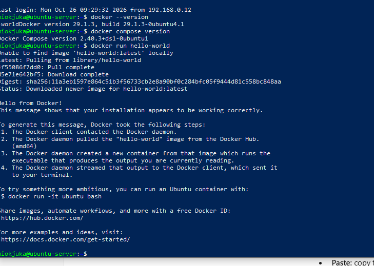
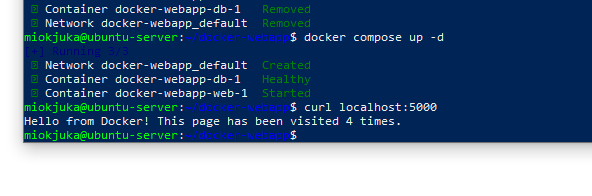
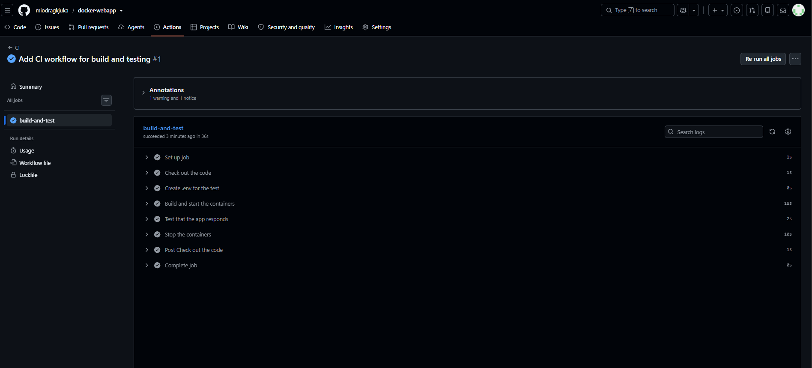

# Dockerized Web App (Flask + PostgreSQL)


# Dockerized Web App ...


A small web app that counts page visits and stores the count in a PostgreSQL database. The web app and the database run as two containers, started together with Docker Compose. I built it inside an Ubuntu Server VM from my [Proxmox homelab](https://github.com/miodragkjuka/proxmox-homelab).

## How it works

```
Browser ──► web container (Flask, port 5000) ──► db container (PostgreSQL 16)
                                                     └── Docker volume: db_data
```

- Each visit to the page adds a row to a `visits` table, then shows the total.
- The database files live in a Docker **volume**, so the data survives restarts of the containers.
- The database password is read from a `.env` file that is not in this repo (`.gitignore` excludes it).

## Files

| File | What it does |
|---|---|
| `app.py` | Flask app that connects to the database and counts visits |
| `requirements.txt` | Python dependencies (Flask, psycopg2) |
| `Dockerfile` | Builds the web app image from `python:3.12-slim` |
| `compose.yaml` | Runs the web and db containers, with a healthcheck and a volume |
| `.gitignore` | Keeps `.env` (the password) out of Git |

## Run it yourself

```bash
git clone https://github.com/miodragkjuka/docker-webapp.git
cd docker-webapp
echo "DB_PASSWORD=choose-a-password" > .env
docker compose up -d --build
curl localhost:5000
```

## Proof it works

### Docker installed on the Ubuntu VM



### Both containers running

`db` is reported healthy, and `web` starts only after the database passes its healthcheck.


### The app in the browser


### Data survives a restart

I ran `docker compose down` (which removes the containers) and then `docker compose up -d`. The counter continued from where it was instead of resetting to 1, because the data is stored in the `db_data` volume.



## CI pipeline (GitHub Actions)

Every push to `master` runs a workflow (`.github/workflows/ci.yml`) that:

1. Checks out the code
2. Creates a test `.env` file
3. Builds the image and starts both containers with Docker Compose
4. Calls the app with `curl` and checks that the page says "Hello from Docker"
5. Stops and removes the containers

If any step fails, the run turns red and the logs show what broke.



## What went wrong and how I fixed it

- **SSH timed out.** My VM got a new IP address from the router (`192.168.0.15` became `192.168.0.19`). I checked the current address with `ip a` in the Proxmox console and connected to the new one. A fixed (static) IP would prevent this.
- **Docker needed a re-login.** After adding my user to the `docker` group, the change only took effect after logging out and back in.
- **Startup order.** The web app can start before PostgreSQL is ready. I solved this with a healthcheck on the database and `depends_on: condition: service_healthy`, plus a retry loop in the app.

## What I learned

- Writing a Dockerfile and building an image
- Running multiple containers with Docker Compose
- Persisting data with volumes
- Keeping secrets out of Git with `.env` and `.gitignore`
- Container networking: the web app reaches the database by its service name, `db`
